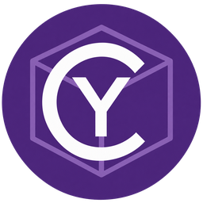

# Cy3DView

**English** · [Français](README.fr.md)

<p align="center">
  
</p>

**Cy3DView by Cyberalien · GNU GPL v3.0**

A 3D model viewer inspired by **CyImgView**: native C++, on-demand GPU rendering,
background loading, bounded caches and formats extensible through plugins.

<a id="licence"></a>

## License

Cy3DView is distributed under **GNU GPL v3.0 only** (`GPL-3.0-only`).
See [LICENSE](LICENSE) and [NOTICE](NOTICE). The software comes without warranty.
Third-party libraries retain their licenses and attribution:
see [docs/THIRD_PARTY.md](docs/THIRD_PARTY.md).

Project repository: [MrMybal/Cy3DView](https://github.com/MrMybal/Cy3DView).

Version 0.6 has a portable Windows / Linux / macOS engine (OpenGL 3.3).
Building and rendering have been verified on Windows; Linux/macOS configurations are planned
in CI. CyImgView itself is currently a Windows application: Cy3DView adopts its principles,
not its Win32/Direct2D code.

<a id="lancer"></a>

## Run

On Windows, download `Cy3DView-<version>-win64-setup.exe` from
[GitHub releases](https://github.com/MrMybal/Cy3DView/releases). The installer offers English/French
and installs in `%LOCALAPPDATA%\Programs\Cy3DView` without administrator rights.
It adds a Start menu entry, optional desktop shortcut and Windows uninstall entry.
A portable ZIP version remains available.

**Updates** checks stable releases, displays their notes, downloads the installer and verifies
its size and GitHub-published SHA-256 hash. **Close app and install** closes the application
and opens the installer in the current folder. Preferences and additional plugins are retained.
The installer offers to relaunch the application. Checks are manual; no update request runs at startup.

Public repositories require no account. For a private repository, optional access requires a
GitHub token with **Contents: read** for that repository; it stays in memory only for the session.
**GitHub releases** also opens the browser. Linux/macOS support checking, with manual installation
from that page.

After building, run `build/Release/bin/Cy3DView.exe`, or `Cy3DView` on Linux/macOS.
Open a file by drag and drop, the built-in browser, **Open** on Windows, or a command-line argument.
Included demos contain a turquoise torus knot and `samples/pbr_studio.gltf`: 18 spheres, metallic
factor from top to bottom and roughness from left to right. `animated_flag.glb`, `colored_cloud.ply`,
`gaussian_cloud.splat` and `usd_scene.usda` demonstrate the new readers.

Keep `plugins/` beside the executable. The application works offline and starts in **English**.
The **English / Français** selector in the top bar switches language immediately. The choice
is saved in `Cy3DView.ini` beside the executable; the folder must be writable to retain it.
The command line also accepts `--language en` or `--language fr`. The purple logo is embedded
in the header, home screen, plugins window and Windows icon. To replace it in the sources,
update `cy3dview-logo-violet.png`, run `python tools/prepare_logo.py` (Pillow is needed only
for this preparation), then rebuild.

<a id="conversion-et-outils"></a>

## Conversion and tools

**Export** converts the scene to GLB, glTF, binary or ASCII FBX, OBJ + MTL, STL and PLY.
**Tools** opens editors supplied by plugins. The first is a UV atlas editor using **xatlas**,
with preview, progress, cancellation and restoration of the previous state. Edits remain on
a copy and can be exported; the source model is preserved.

See [conversion formats and limits](docs/EXPORTING.md) and
[the API for adding exporters or tools](docs/PLUGIN_EXTENSIONS.md).

<a id="fonctions-disponibles"></a>

## Available features

- Triangles, normals, material colors and external or embedded color textures.
- **Metallic/roughness PBR**: GGX BRDF, Fresnel, direct lighting and a built-in HDR studio.
- Studio reflections prefiltered by roughness, ambient diffuse lighting and a BRDF integration table.
- Color, metal, roughness, normal, occlusion and emission textures; shared images are deduplicated.
- Color/emission textures in sRGB, linear material data, exposure and tone mapping.
- glTF import of ORM channels, UV0/UV1, UV transforms, repeat/clamp/mirror, normal strength,
  occlusion, emission, unlit materials and opaque/mask/blend alpha modes.
- Exposure, studio intensity/orientation controls; normal mapping and occlusion can be disabled.

Material mapping follows the [Khronos glTF 2.0 specification](https://registry.khronos.org/glTF/specs/2.0/glTF-2.0.html#materials).

Other features:

- Transform and skeletal animation, GPU vertex deformation, clip selection, play/pause,
  looping, speed and timeline seeking.
- Linear and STEP interpolation, spherical rotation interpolation and bone display.
- Vertex colors, point clouds with adjustable size and anisotropic Gaussian splats.
- Scene transforms and instances: a shared mesh is imported/uploaded to the GPU only once.
- Orbit camera, continuous **WASD or ZQSD** movement, zoom, automatic framing and fullscreen.
- English/French interface, English by default, immediate switching and saved preference.
- Material, clay, normal and wireframe modes; optional grid and automatic rotation.
- Folder browser with natural sorting, search filter and model navigation.
- Dedicated loading thread that cancels obsolete requests.
- Animated loading banner, current stage, elapsed time and percentage during GPU preparation.
- Progressive GPU upload of vertices, indices and textures; the previous model remains visible until completion.
- Explicit cancellation through Escape or Cancel, including during GPU upload.
- **256 MiB** scene LRU cache, invalidated when the model or its dependencies change.
- GPU LRU cache of **256 MiB estimated**: unchanged scene buffers are reused on return.
- Preloading of two neighbors, including after reading the folder of a file opened at startup.
- Texture decompression on the import thread, with a **256 MiB** RGBA budget per scene.
- Rendering only on events, except during keyboard movement, loading, input, animation or automatic rotation.
- Geometry, dimensions, import time, GPU upload time and estimated memory information.
- Browser rows drawn only when visible, with indexed filtering and navigation.
- Viewport PNG screenshots, with confirmation before replacing an existing file.

| Shortcut / gesture | Action |
|---|---|
| Ctrl+O | Open (Windows picker; built-in browser elsewhere) |
| Left drag | Orbit |
| Right / middle drag | Pan camera |
| WASD / ZQSD | Move forward, backward and sideways relative to the camera |
| Shift + WASD / ZQSD | Move four times faster |
| Wheel | Zoom |
| Home / double-click | Recenter |
| Left / right | Previous / next model |
| F / G / T | Wireframe / grid / textures |
| Space | Automatic rotation |
| F11 / Escape | Fullscreen / cancel loading or leave fullscreen |
| Ctrl+S | PNG screenshot |

Both keyboard layouts work simultaneously: W/Z forward, A/Q left, S backward and D right.
Speed depends on model scale and zoom, stays constant diagonally and is independent of frame
rate. Movement is blocked during loading, text input, control use, dialogs or loss of focus.
Releasing the keys returns rendering to idle.

## Formats

**Native STL**: dedicated ASCII/binary reader, memory-mapped input without copying, cancellation
and size checks. Per-face vertices preserve sharp edges; this reader favors speed and uses
more memory than Assimp's vertex welding.

**Assimp 6.0.2**: OBJ/MTL, FBX, glTF/GLB, PLY, Collada/DAE, 3DS, 3MF, OFF, X, LWO,
DXF, IFC and other extensions advertised by the library. The exact list comes from the built
plugin, through **Plugins** or `cy3d_probe --formats`. An advertised extension does not guarantee
compatibility with every version/variant of that format.

**Native point clouds**: ASCII and little-/big-endian binary PLY, XYZ and PTS with positions
and colors. PLY with faces goes to Assimp. XYZ/PTS accept XYZ, XYZ RGB or XYZ intensity RGB,
with RGB from 0 to 255; PTS starts with a point count. PLY properties may be reordered;
floating-point PLY colors are interpreted from 0 to 1.

**Gaussian Splatting**: 32-byte-per-point `.splat` (positions, scales, RGBA and WXYZ quaternion),
and Gaussian PLY with `f_dc_*`, `opacity`, `scale_*`, `rot_*`. Anisotropic covariance projection,
Gaussian transparency and radix depth sorting. Directional SH coefficients above degree 0
are ignored; `.ksplat`, `.spz` and streaming scenes beyond available memory are not supported yet.

**USD / USDA / USDC / USDZ**: experimental native reader using pinned Assimp and tinyusdz.
All four containers are tested, including a USDC made with Blender 5.2. This does not guarantee
all USD compositions, variants, materials and animations. USD files are reread on each opening
because the upstream reader does not expose all external dependencies to the cache.
Prefer self-contained/flattened scenes for this initial integration.

**Recent Blender**: automatic conversion plugin using an installed Blender, followed by the
GLB reader. Verified with Blender 5.2.1, including animation and skinning. Embedded scripts
are disabled. Blender is not bundled; `CY3D_BLENDER` can specify its executable. Procedural
materials that cannot be exported to glTF are not automatically baked. Texture references
exported with an invalid UV index are corrected: the main UV set is used when available;
otherwise constant PBR values from the Blender material replace those textures, with a warning.
Conversion does not change the source `.blend` file.

**Unreal `.uasset`**: optional bridge using the project's matching Unreal Editor.
Verified on Windows with UE 5.6 and StaticMesh assets under `/Engine/` and `/Game/`.
The file must retain its location in `Content`, its `.uproject` and dependencies.
Only uncooked StaticMesh/SkeletalMesh are accepted, not game packages, Blueprints, worlds,
native project classes or specific plugin mounts. `CY3D_UNREAL_EDITOR` selects the
`UnrealEditor-Cmd` executable. Source assets are not saved. Material baking is disabled to
avoid shader compilation; glTF-exportable expressions are retained and others may be simplified.
Separate AnimationSequence clips are not automatically associated with a SkeletalMesh.

Both bridges run a background conversion on first access and may take several seconds.
Converted GLBs are cached in the temporary `Cy3DView-conversions` folder with a 256 MiB budget,
invalidated on file, dependency, tool or script changes. Loading can be canceled; conversion
processes are limited to four minutes. Unreal detection currently targets Windows; elsewhere
use the environment variable.

Proprietary CAD formats and Draco-compressed geometry are absent from this build.
Assimp's advertised STEP/STP refers to its specific importers, not a general CAD engine.

Morph targets, constraints, simulations and exact CUBICSPLINE curves remain to be added.
For CUBICSPLINE, Assimp does not retain tangents, so linear/spherical interpolation is used
with a warning. At most four bone influences are retained per vertex. Initial framing uses
the imported pose's dimensions; large movement may require zooming out.

PBR covers metallic/roughness. Clearcoat, transmission, sheen, anisotropy and specular/glossiness
are not interpreted faithfully. Custom HDR environment import, cast shadows, SSAO and
antialiasing are not available yet. Occlusion comes from material textures. Transparency is
sorted by instance center without triangle sorting, so intersecting surfaces may be incorrect.
Normal maps use a tangent basis reconstructed from UV derivatives; custom file tangents are
not retained. UV0 and UV1 are available; materials requesting UV2 or higher are rejected with
a diagnostic. Sampling uses linear filters with mipmaps. For OBJ/FBX and other formats,
retained properties depend on what Assimp exposes; older diffuse materials receive zero metal
and roughness derived from shininess when available. Displayed units follow the file;
the Unreal bridge converts centimeters to meters.

<a id="compiler"></a>

## Build

Windows: Visual Studio 2022, C++ workload, and CMake/Ninja supplied by Visual Studio.

```powershell
.\build.ps1
.\build.ps1 -Config Debug
```

Linux: C++20 compiler, CMake 3.24+, Ninja, OpenGL/X11 development libraries and libcurl.

```sh
cmake -S . -B build/Release -G Ninja -DCMAKE_BUILD_TYPE=Release -DGLFW_BUILD_WAYLAND=OFF
cmake --build build/Release --parallel
```

macOS: Xcode tools, CMake and Ninja; the same commands without the X11/Wayland option.
Apple still provides OpenGL 3.3 through its core profile, but the API is deprecated there.

Dependencies download automatically on the first CMake run, with pinned versions and SHA-256.
If CMake downloads fail, `python tools/fetch_deps.py` prepares `third_party/`.
Local dependencies are reused; the static MSVC build requires no C++ redistributable runtime.

<a id="vérifier-et-mesurer"></a>

## Verify and measure

```sh
ctest --test-dir build/Release --output-on-failure
build/Release/bin/cy3d_probe --test tests/fixtures
build/Release/bin/cy3d_probe my_model.glb 5
```

Tests cover textured OBJ, ASCII/binary STL, PLY, glTF transformed instances, GLB embedded
textures, accented paths, invalid/truncated/missing files, cancellation, cache and request
ordering. `gpu` tests require a graphics session (Xvfb + Mesa on Linux). The Assimp corpus
also checks FBX, Collada and 3MF, including a skeletal FBX and animated Collada.

GPU tests verify progressive preparation, cancellation, preservation of the previous display
on errors, textures and GPU cache. PBR tests verify factors, ORM channels, UV transforms,
normal maps, occlusion, emission, exposure, sRGB, alpha and actual studio-scene rendering.
They generate screenshots and `build/Release/pbr-metrics.json`, with GPU timing separate from
the CPU time displayed in the interface. Extended tests cover clips, STEP, hierarchy, GPU
deformation, skeleton, playback/looping, seven cloud/splat encodings, four USD extensions
and accented paths.

USDC/.blend fixtures are produced by `tools/make_bridge_fixtures.py` in Blender; the others
by `tools/make_extended_fixtures.py`. Generated files ship with the sources. To enable local
bridge tests, configure CMake with `CY3D_TEST_BLENDER` (executable) and/or `CY3D_TEST_UNREAL_ASSET`
(uncooked mesh in Content). These have the `integration` label. `blender_texture_regression`
reproduces negative UV indices and checks material values, valid UVs and preservation of binary
data. `--loading-smoke model capture.png` produces two loading screenshots and a final screenshot
to visually check the animated indicator.

```sh
python tools/generate_benchmark.py --triangles 200000
build/Release/bin/cy3d_probe --plugin build/Release/bin/plugins/cy3d_stl.dll build/benchmark.stl
build/Release/bin/cy3d_probe --plugin build/Release/bin/plugins/cy3d_assimp.dll build/benchmark.stl
```

These measure CPU import without GPU upload. Repeat them on representative models before
making general speed claims. Assimp imports use working memory in addition to the final scene;
the 2 GiB limit applies to output, not peak process memory. GPU upload is split into 1 MiB
blocks on the graphics thread with a per-turn submission budget. Buffer allocation and mipmap
generation may still exceed this budget depending on the driver. The active model and scene
being prepared add to cache limits when they do not fit. See
[initial measurements and their limits](docs/PERFORMANCE.md).

<a id="distribuer"></a>

## Distribute

```sh
cmake --install build/Release --prefix dist/Cy3DView
```

Output includes the application, plugins, sample, documentation and third-party licenses.
The Windows installer adds shortcuts and offers the application in “Open with” without changing
the user's default software. Update checks remain manual.

On Windows, `powershell -File tools/package.ps1` builds, tests, prepares the portable folder,
checks rendering and produces a ZIP and installer using the project version.
Inno Setup 6.7 or newer is required for the installer;
`tools/build_installer.ps1 -Compiler <path-to-ISCC.exe>` specifies its location.
`-SkipBuild` reuses an existing build. `tools/installer_test.ps1` checks an isolated install,
update and uninstall with a dedicated Windows test identity. It verifies installed files
and model imports from installed plugins. Rendering requires OpenGL 3.3.

On Windows CI virtual machines, `-AllowMissingOpenGL` tolerates only explicit incompatible-driver
messages; other errors remain blocking. Import/render logs are kept in the test folder.
Graphics tests remain mandatory by default locally and in Linux CI with Mesa/Xvfb.

See [changes](docs/CHANGELOG.md), [the plugin API](docs/PLUGIN_API.md)
and [dependencies](docs/THIRD_PARTY.md).
